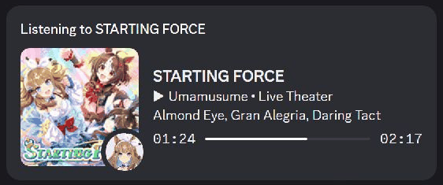
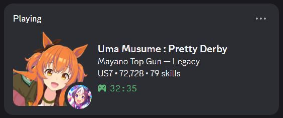

# UmaPresence

Show your friends which race you’re in, whose Legacy you’re viewing, or who’s on stage in Live Theater, right from your Discord profile. UmaPresence follows what you’re doing in **Umamusume: Pretty Derby (JP DMM)** and updates your activity card as you play.

**Windows x64 · JP DMM · Discord desktop**

UmaPresence started as an independent take on the Discord Rich Presence feature in KevinVG207’s [UmaLauncher](https://github.com/KevinVG207/UmaLauncher#better-discord-rich-presence-for-uma-musume).

> **This is an unofficial third-party app.** Rich Presence reads what’s happening in the game and sends it to Discord. Setup loads a bridge in the game through Hachimi Edge or Standalone. Standalone also offers optional controls for concert playback and casting. Proceed with caution, especially after a game update.

## See it in Discord

**Live Theater · STARTING FORCE.** The card shows the song, cast, and playback progress. The cast portrait rotates, and hovering over it reveals the singer’s costume and voice actor.

**Legacy · Mayano Top Gun.** Open a Legacy profile and Discord shows the Uma’s portrait, rank, evaluation score, and skill count. This one is US7 with a score of 72,728 and 79 skills.

## What Discord can show

- **Home and menus.** Home, Veterans, character and support card collections, deck editing, and Scout results.
- **Career.** Preparing a career, training, learning skills, and reviewing results.
- **Uma profiles.** Legacy, Bare Legacy, Practice Partners, and Rivals, with rank, costumes, and profile details where available.
- **Races.** Preparation, live standings, and results for Career races, Champions Meeting, Room Matches, League of Heroes, and Master Challenge.
- **Live Theater.** Concert selection, song title, cast, and playback progress.
- **Story, Story Events, and Missions.**

And more…

## Download and set up

Download the Windows app ZIP from the [public prerelease](https://github.com/BenDore1810/UmaPresence/releases/tag/v0.1.0-beta.1). See [BUILD.md](BUILD.md) if you want to build from source.

This prerelease uses manual updates from GitHub Releases. See `acceptance.json` in the app ZIP for the checks that are still pending.

1. Extract the entire app ZIP into a new writable folder and run `UmaPresence.exe`. The app requires Windows x64 and .NET Framework 4.8.
2. On first launch, choose **Set up game integration** to confirm the detected game folder, or **Skip for now** to open Overview. Use **Browse…** in Game integration if the folder is blank or you want a different folder. Steam and Global are unsupported.
3. Close the game. For **Standalone**, download or select the official Cellar helper, then click **Install Standalone**. For an existing supported **Hachimi Edge** setup, choose **Hachimi** and click **Apply switch**. UmaPresence installs and registers the bridge for the selected mode.
4. Wait for the success message, then launch through DMM. If Hachimi’s built-in Discord activity is enabled, turn it off before launching so UmaPresence can publish activity.
5. Enable Discord activity sharing. The public application ID needs no token or login. Never enter your Discord token.

The game engine is copied only from your own installation. The ZIP includes the UmaPresence loader and bridge. Obtain the game, official engine, Cellar helper and Hachimi separately.

## After an update

If Hachimi still sends your activity, keep using it. After a DMM update, open **Game integration → Check compatibility**. When a verified Standalone update is offered, close Umamusume, click **Install Standalone update**, and launch through DMM. If detailed presence is unavailable, the game can still run and Discord can show **Playing Umamusume**. Full uninstall remains available.

If only the language pack changed, use **Data & artwork → Reload translations**.

## Controls

Concert progress uses the game's playback clock. The bar appears while paused by default. Choose **Always during a concert** or **Off** under **Concert** to change that. When the white handle appears, drag it within the range that the active audio tracks share and release to seek. Windows media controls are independent. Hachimi mode uses Hachimi's concert controls.

In Standalone mode, enable **Use the same Uma in multiple slots** in Concert settings and save, then select duplicates on the game's formation screen. Concert playback uses the game's original arrangement. Experimental audio arrangements and vocal balancing are disabled.

## Concert covers

Leave **Presence → Prefer original song covers** checked to use the default artwork. The public download comes with no custom song covers configured.

If you have upload access to the Discord application UmaPresence uses, you can set a custom cover for a song.

1. Open **Data & artwork → Song covers**. To generate a PNG from the concert currently playing, use **Generate current cover** and **Open cover folder**. You can also supply your own PNG.
2. Click **Open Discord assets** and upload the cover to the application that opens.
3. Back in UmaPresence, select the song, enter the uploaded **Discord asset name**, check **I uploaded this asset to this Discord application**, and click **Register uploaded asset**.
4. Open **Presence**, clear **Prefer original song covers**, and click **Save changes**. Songs without a registered cover use the original artwork when available. Discord may take a moment to show the new cover.

## Restore or remove

Close the game before switching. In Game integration, use **Uninstall UmaPresence integration…** to remove the bridge, restore the previous game loader, and keep the app available. Use **Full uninstall…** to also close the app and permanently remove the extracted package files, settings, generated caches, and sign-in startup entry. Keep the original ZIP for reinstalling into a fresh folder. Extract each copy into its own folder so its package files can be removed separately from your other files.

If removal was interrupted, close the game and click **Full uninstall…** again. An active Hachimi loader and translation files stay in place. **Return to stock DMM** changes how the game starts and keeps saved Hachimi files for later.

## Before sharing diagnostics

Review the report locally. Remove game paths, Windows username, trainer/account identifiers, roster details and any unrelated personal information. Reports and logs are local files and are not part of the release. Never attach tokens, original engine DLLs, backups, recordings or complete diagnostic captures.

## Verification and source

Check ZIP hashes against SHA256SUMS.txt. The binary package includes a per-file checksum manifest. Corresponding source is supplied separately under GPL-3.0; see NOTICES.md and BUILD.md. No installation or launch is performed by packaging.
